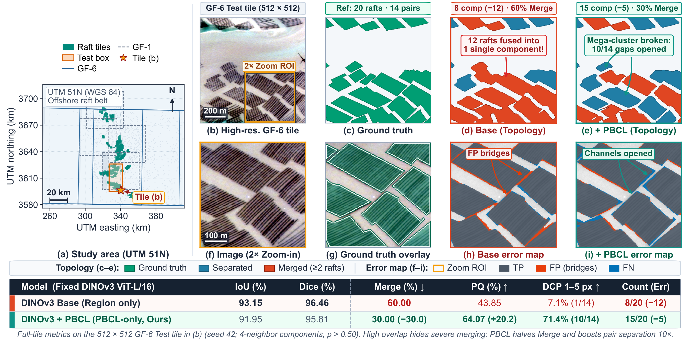
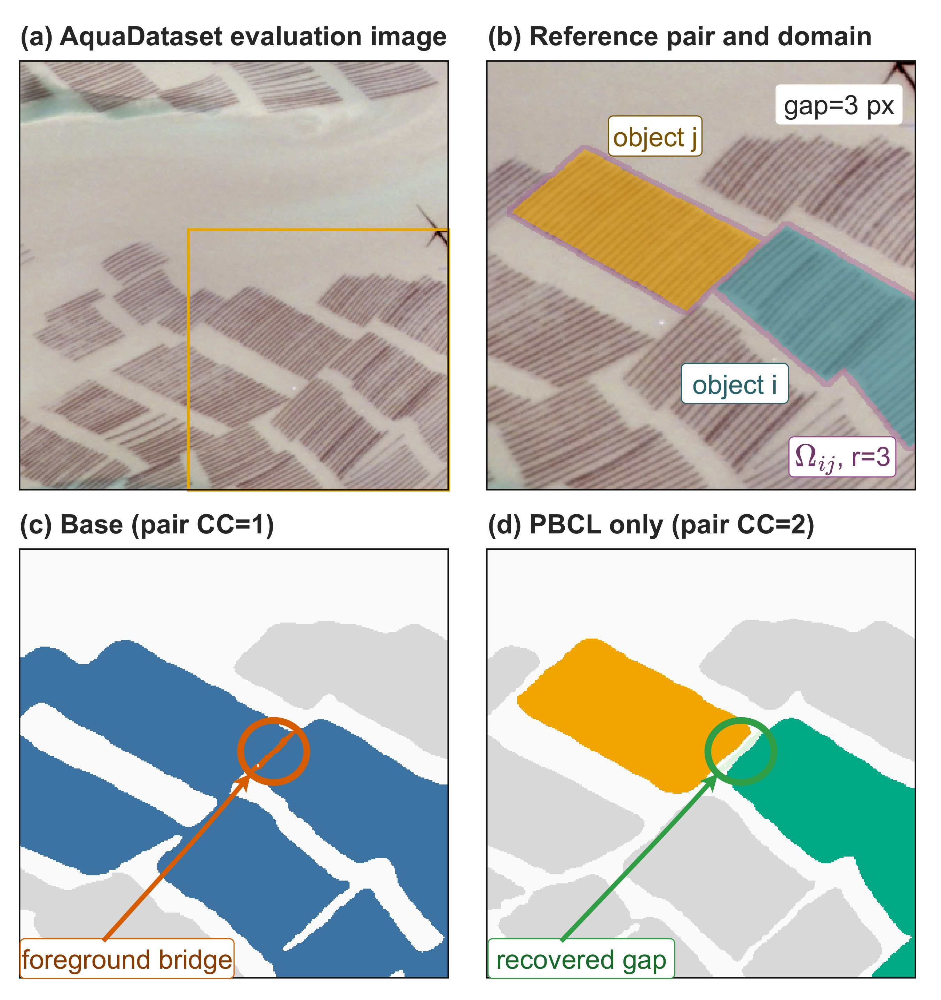
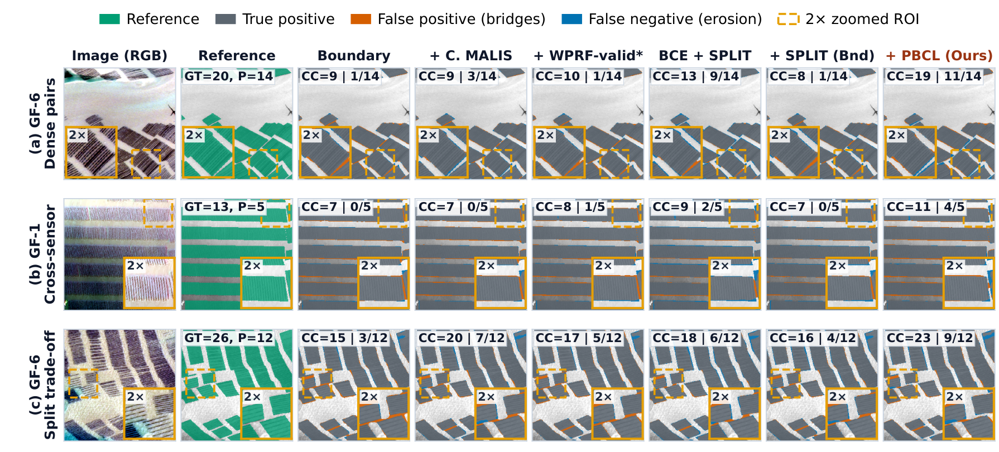
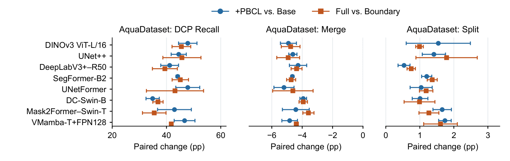
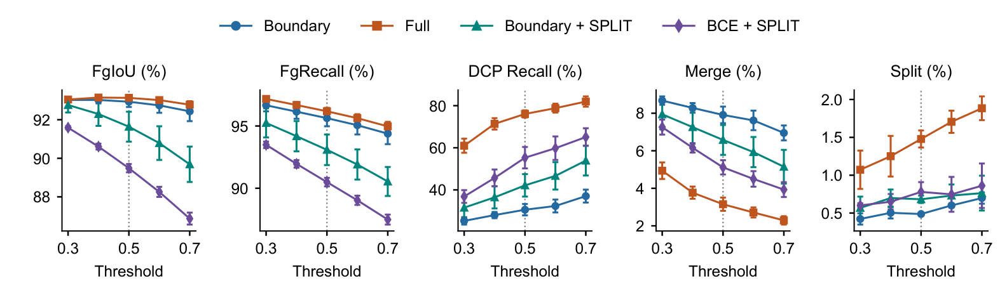

# PBCL: Pairwise Bottleneck Connectivity Loss for Structurally Separable Raft-Aquaculture Mapping

<p align="center">
  <strong>English</strong> | <a href="README_CN.md">简体中文</a>
</p>

<p align="center">
  <a href="https://pytorch.org/"></a>
  <a href="LICENSE"></a>
  <a href="#reproducing-paper-results"></a>
</p>

Official implementation and reproducibility suite for **Pairwise Bottleneck Connectivity Loss (PBCL)**:

> **Pairwise Bottleneck Connectivity Loss for Structurally Separable Raft-Aquaculture Mapping**  
> Xiangteng Zang, Changsheng Zhu, Haojie Li, Yan Lu, and Binge Cui  
> *Shandong University of Science and Technology*

---

## Highlights & Core Findings

Dense raft aquaculture contains narrow water gaps (1–5 pixels) whose erroneous bridging merges distinct objects despite >93% foreground IoU. **PBCL** is a **training-only, plug-and-play structural loss** defined directly on the binary foreground-probability map used at inference—adding **zero trainable parameters and zero inference overhead**.

<p align="center">
  
</p>

* **Consistent multi-loss superiority on identical fixed carriers**: On both **DINOv3 ViT-L/16** and lightweight **SegFormer-B2**, PBCL substantially outperforms pixel-reweighting (**EW-BCE**), skeleton-continuity (**soft-clDice**), affinity/maximin (**Constrained MALIS**), reachability (**WPRF-GT\***, **WPRF-valid\***), and contour-suppression (**BCE + SPLIT**, **Boundary + SPLIT**) losses in near-pair separation (DCP Recall), Merge rate, panoptic quality (PQ), and counting accuracy (Count NMAE).
* **Targeted gap opening vs. perimeter erosion**: Under foreground-recall-matched evaluation, SPLIT collapses below the Boundary baseline on both carriers (revealing that its fixed-threshold separation stems from global perimeter erosion), whereas PBCL preserves **+45.29 pp** (DINOv3) and **+39.22 pp** (SegFormer-B2) DCP Recall gains.
* **Architecture-agnostic generality (48/48 paired seed wins)**: Across **8 binary architectures** spanning CNN, Transformer, hybrid, and Mamba families (**DINOv3 ViT-L/16, UNet++, DeepLabV3+-R50, SegFormer-B2, UNetFormer, DC-Swin-B, Mask2Former-Swin-T, VMamba-T+FPN128**), PBCL improves DCP Recall and reduces Merge in **every single one of 48 seed-paired comparisons** (exact two-sided architecture-level sign/Wilcoxon test, $p = 0.0078$).
* **Large-region mosaicking & cross-domain transfer**: On four zero-overlap GF-1/GF-6 Test corridors ($\approx 286$–$297\text{ km}^2$ each), PBCL raises macro PQ from **78.31% → 84.16%** and cuts Count NMAE from **13.52% → 4.04%** (Post, 64-px interior filter). On **SpaceNet 2 Vegas** dense buildings (16,669 buildings), PBCL again delivers the strongest same-carrier DCP Recall (**63.54%** vs. **54.43%** Boundary) across all 8 architectures (48/48 wins).

---

## Method Overview & Standalone Usage

PBCL extracts each neighboring instance pair $(G_i, G_j)$ within gap $g_{ij} \le 5\text{ px}$, forms a local padded interaction band $B_{ij}^{(r)}$ ($r=3$), and runs $K=9$ differentiable four-neighbor max–min propagation steps directly on the predicted probability map $P = \sigma(Z)$ to evaluate the strongest bounded-length bridge score $c_{ij}$. Any bridge exceeding the safety threshold $\tau - m$ ($0.5 - 0.1 = 0.4$) receives a squared hinge penalty:

$$\mathcal{L}_{\mathrm{PBCL}} = \frac{1}{|\mathcal{P}|}\sum_{(i,j)\in\mathcal{P}} \max\bigl(0,\; c_{ij} - (\tau - m)\bigr)^2$$

<p align="center">
  
</p>

### Drop-in PyTorch Module (`pbcl`)

You can integrate PBCL into any binary segmentation network in a few lines with zero GeoSeg boilerplate:

```python
import torch
from pbcl import PairwiseBottleneckConnectivityLoss

criterion = PairwiseBottleneckConnectivityLoss(
    band_radius=3,   # interaction band radius r
    iterations=9,    # four-neighbor max-min propagation steps K
    threshold=0.5,   # binary decision threshold tau
    margin=0.1,      # safety margin m (penalizes bridge score > 0.4)
)

# logits: (B, 1, H, W) binary segmentation logits
# instance_maps: (B, H, W) integer instance IDs (0 = background, 1..N = instances)
# Optional: pass precomputed `instance_pairs` for fast large-scale training
pbcl_loss, mean_bottleneck, num_pairs = criterion(
    logits, instance_maps, return_stats=True
)
total_loss = seg_loss + 0.1 * pbcl_loss
```

---

## Main Experimental Results & Multi-Loss Comparisons

All reported numbers below are three-seed means ± sample SD (seeds 42, 43, 44) and can be verified programmatically against the bundled [`results/`](results/) tables via:

```bash
python run.py verify-results
```

### 1. Same-Carrier Multi-Loss Comparison on AquaDataset Test (Table IV)

All rows within each carrier share identical architecture, initialization, spatial-holdout split, optimizer schedule, seeds, and validation checkpointing.

| Carrier / Training Objective | Fg IoU ↑ | B-F1 ↑ | PQ ↑ | Merge ↓ | Split ↓ | DCP Recall ↑ | Count NMAE ↓ |
| --- | :---: | :---: | :---: | :---: | :---: | :---: | :---: |
| ***Primary carrier: DINOv3 ViT-L/16*** | | | | | | | |
| Boundary | 92.94 ± 0.28 | 89.36 ± 0.82 | 80.42 ± 0.84 | 7.91 ± 0.44 | 0.49 ± 0.00 | 30.59 ± 2.70 | 12.59 ± 1.06 |
| Boundary + EW-BCE | 93.23 ± 0.01 | 90.16 ± 0.08 | 81.94 ± 0.52 | 6.56 ± 0.68 | 0.73 ± 0.21 | 39.41 ± 5.97 | 10.53 ± 0.62 |
| Boundary + soft-clDice | 93.02 ± 0.06 | 89.57 ± 0.14 | 80.21 ± 0.36 | 9.34 ± 0.07 | 0.50 ± 0.16 | 20.00 ± 0.59 | 12.31 ± 0.32 |
| Boundary + Constrained MALIS | 93.13 ± 0.02 | **90.23 ± 0.21** | 81.77 ± 0.08 | 6.22 ± 0.39 | 0.67 ± 0.03 | 42.75 ± 3.74 | 10.12 ± 0.44 |
| Boundary + WPRF-GT\* | 93.17 ± 0.09 | 89.93 ± 0.31 | 80.98 ± 0.36 | 7.78 ± 0.25 | **0.44 ± 0.08** | 30.59 ± 1.56 | 11.89 ± 0.67 |
| Boundary + WPRF-valid\* | **93.24 ± 0.12** | 90.17 ± 0.34 | 81.08 ± 0.54 | 7.34 ± 0.31 | 0.57 ± 0.16 | 33.14 ± 1.80 | 11.60 ± 0.59 |
| BCE + SPLIT (Eq. 15) | 89.49 ± 0.21 | 76.50 ± 1.09 | 75.42 ± 0.54 | 5.12 ± 0.38 | 0.78 ± 0.13 | 55.29 ± 5.09 | 10.06 ± 0.58 |
| Boundary + SPLIT | 91.64 ± 0.78 | 84.66 ± 2.72 | 78.75 ± 0.28 | 6.58 ± 0.80 | 0.68 ± 0.05 | 42.16 ± 5.34 | 10.64 ± 1.02 |
| **Boundary + PBCL (Full, ours)** | 93.14 ± 0.07 | 89.98 ± 0.34 | **83.36 ± 0.23** | **3.15 ± 0.35** | 1.48 ± 0.11 | **76.08 ± 1.70** | **8.19 ± 0.13** |
| ***Lightweight carrier: SegFormer-B2*** | | | | | | | |
| Boundary | **92.91 ± 0.06** | **89.53 ± 0.12** | 78.97 ± 0.15 | 8.54 ± 0.10 | 0.89 ± 0.07 | 24.31 ± 0.90 | 14.68 ± 0.07 |
| Boundary + EW-BCE | 92.87 ± 0.13 | **89.53 ± 0.22** | 79.41 ± 0.30 | 7.78 ± 0.03 | 1.17 ± 0.15 | 29.61 ± 0.34 | 14.02 ± 0.25 |
| Boundary + soft-clDice | 92.23 ± 0.06 | 87.09 ± 0.36 | 78.25 ± 0.25 | 10.12 ± 0.20 | **0.37 ± 0.17** | 15.29 ± 1.02 | 12.80 ± 0.32 |
| Boundary + Constrained MALIS | 92.86 ± 0.08 | 89.23 ± 0.21 | 79.28 ± 0.15 | 7.60 ± 0.05 | 0.99 ± 0.10 | 31.96 ± 0.90 | 14.02 ± 0.37 |
| Boundary + WPRF-GT\* | 92.83 ± 0.08 | 89.24 ± 0.18 | 78.41 ± 0.39 | 8.87 ± 0.19 | 0.84 ± 0.12 | 20.98 ± 1.22 | 15.03 ± 0.54 |
| Boundary + WPRF-valid\* | 92.85 ± 0.09 | 89.31 ± 0.17 | 78.64 ± 0.19 | 8.76 ± 0.16 | 0.94 ± 0.15 | 21.37 ± 0.90 | 14.65 ± 0.45 |
| BCE + SPLIT (Eq. 15) | 88.13 ± 0.18 | 71.99 ± 0.66 | 72.02 ± 0.22 | 5.96 ± 0.03 | 1.06 ± 0.32 | 43.53 ± 0.00 | 13.06 ± 0.05 |
| Boundary + SPLIT | 90.79 ± 0.08 | 82.07 ± 0.28 | 76.29 ± 0.13 | 7.20 ± 0.03 | 1.12 ± 0.13 | 35.10 ± 0.90 | 12.87 ± 0.35 |
| **Boundary + PBCL (Full, ours)** | 92.82 ± 0.08 | 89.32 ± 0.13 | **80.71 ± 0.17** | **3.82 ± 0.20** | 2.26 ± 0.14 | **69.41 ± 2.12** | **11.81 ± 0.68** |
| *External native-instance anchor: Mask2Former-Swin-T (Inst.)* | *93.01 ± 0.13* | *90.06 ± 0.13* | *84.72 ± 0.44* | *4.14 ± 0.42* | *3.87 ± 0.27* | *80.20 ± 2.96* | *7.24 ± 0.37* |

<p align="center">
  
</p>

> **Why does PBCL outperform competing structural losses?**
> * **soft-clDice** enforces foreground skeleton continuity, which opposes inter-raft separation and degrades DCP Recall below Boundary.
> * **WPRF-GT\*** operates on a skeleton-derived support graph where 0/265,713 precomputed negative queries admit a valid support path across disjoint polygons; even with valid-grid support (**WPRF-valid\***, 19.05% active scale-16 negative queries), it trails PBCL by **42.94–48.04 pp** in DCP Recall.
> * **SPLIT** penalizes every dilated semantic contour uniformly, eroding object perimeters (Fg IoU drops to 88.13–89.49%); once foreground recall is equalized to Boundary@0.50, **BCE + SPLIT** and **Boundary + SPLIT** collapse to **24.71% / 29.61%** DCP Recall on DINOv3 (below Boundary's 30.59%), whereas **PBCL retains 75.88%**!

---

### 2. Architecture-Agnostic 2×2 Supervision Factorial Across 8 Networks (Table II)

Adding PBCL improves DCP Recall and reduces Merge in **48/48 paired seed comparisons** across CNN, Transformer, hybrid, and Mamba architectures (exact two-sided sign/Wilcoxon $p = 0.0078$):

| Architecture | Base DCP ↑ | Full (PBCL) DCP ↑ | Base Merge ↓ | Full Merge ↓ | Base PQ ↑ | Full PQ ↑ | Base Count ↓ | Full Count ↓ |
| --- | :---: | :---: | :---: | :---: | :---: | :---: | :---: | :---: |
| **DINOv3 ViT-L/16** | 28.04 | **76.08** | 8.19 | **3.15** | 80.65 | **83.36** | 12.93 | **8.19** |
| **UNet++** | 26.86 | **71.96** | 8.46 | **3.64** | 74.40 | 76.86 *(77.28 PBCL-only)* | 18.81 | 17.74 *(16.55 PBCL-only)* |
| **DeepLabV3+-R50** | 23.14 | **60.78** *(64.31 PBCL-only)* | 8.76 | **4.60** | 77.81 | **79.62** | 13.95 | **10.43** |
| **SegFormer-B2** | 23.53 | **69.41** | 8.54 | **3.82** | 78.48 | **80.71** | 15.16 | **11.81** |
| **UNetFormer** | 17.84 | **62.75** *(65.69 PBCL-only)* | 9.41 | **4.58** | 78.00 | **81.06** | 15.33 | **10.28** |
| **DC-Swin-B** | 18.04 | **57.65** | 9.44 | **5.10** | 78.94 | **81.13** | 13.03 | **9.86** |
| **Mask2Former-Swin-T** | 35.10 | **74.51** *(78.04 PBCL-only)* | 7.12 | **3.20** | 81.42 | **83.00** | 10.82 | **7.78** |
| **VMamba-T+FPN128** | 26.67 | **73.53** | 8.02 | **3.22** | 79.44 | **81.41** | 12.91 | **9.58** |

<p align="center">
  
</p>

---

### 3. Zero-Overlap Full-Scene Mosaicking (Table V) & Cross-Domain SpaceNet 2 Vegas (Table VI)

**Zero-Overlap Test-Corridor Mosaicking (S1–S4, GF-1/GF-6, equal-scene macro, DINOv3 ViT-L/16):**

| Setting | Fg IoU ↑ | B-F1 ↑ | PQ ↑ | Merge ↓ | Split ↓ | DCP Recall ↑ | Count NMAE ↓ |
| --- | :---: | :---: | :---: | :---: | :---: | :---: | :---: |
| Boundary macro (Raw) | 92.97 ± 0.39 | 88.50 ± 1.00 | 76.31 ± 2.21 | 13.84 ± 0.38 | 0.46 ± 0.05 | 29.34 ± 0.89 | 15.36 ± 4.92 |
| **Full macro (Raw)** | **93.14 ± 0.20** | **89.27 ± 0.49** | **81.71 ± 3.36** | **6.15 ± 0.68** | 1.34 ± 0.23 | **71.37 ± 2.86** | **7.37 ± 7.92** |
| Boundary macro (Post, 64-px) | 92.97 ± 0.39 | 88.53 ± 1.04 | 78.31 ± 0.32 | 13.84 ± 0.38 | 0.39 ± 0.05 | 28.66 ± 1.16 | 13.52 ± 0.61 |
| **Full macro (Post, 64-px)** | **93.15 ± 0.19** | **89.31 ± 0.42** | **84.16 ± 0.78** | **6.15 ± 0.68** | 1.22 ± 0.30 | **71.09 ± 2.62** | **4.04 ± 2.11** |

**Cross-Domain SpaceNet 2 Vegas Dense Buildings (568 tiles, 16,669 buildings, SegFormer-B2 carrier):**

| Training Objective | Fg IoU ↑ | B-F1 ↑ | PQ ↑ | Merge ↓ | Split ↓ | DCP Recall ↑ | Count NMAE ↓ |
| --- | :---: | :---: | :---: | :---: | :---: | :---: | :---: |
| Base | 85.26 ± 0.10 | 81.75 ± 0.10 | 71.25 ± 0.14 | 3.80 ± 0.16 | 1.08 ± 0.08 | 53.52 ± 1.22 | 7.90 ± 0.20 |
| Boundary | 85.31 ± 0.06 | 81.97 ± 0.07 | 71.17 ± 0.20 | 3.83 ± 0.07 | 1.15 ± 0.08 | 54.43 ± 0.04 | 7.80 ± 0.06 |
| Boundary + EW-BCE | **85.35 ± 0.03** | 82.04 ± 0.06 | 71.31 ± 0.27 | 3.36 ± 0.06 | 1.23 ± 0.06 | 58.87 ± 0.53 | 7.81 ± 0.10 |
| Boundary + soft-clDice | 84.28 ± 0.02 | 78.25 ± 0.04 | 70.51 ± 0.15 | 5.95 ± 0.18 | **0.89 ± 0.01** | 50.90 ± 0.62 | 7.91 ± 0.06 |
| Boundary + Constrained MALIS | 84.87 ± 0.06 | 80.78 ± 0.10 | 71.11 ± 0.13 | 2.94 ± 0.02 | 1.26 ± 0.03 | 55.85 ± 0.47 | 7.63 ± 0.11 |
| Boundary + WPRF-valid\* | **85.35 ± 0.09** | **82.06 ± 0.08** | **71.77 ± 0.11** | 3.42 ± 0.13 | 1.05 ± 0.03 | 56.23 ± 1.08 | **7.34 ± 0.13** |
| BCE + SPLIT (Eq. 15) | 79.84 ± 0.13 | 70.55 ± 0.31 | 65.22 ± 0.18 | **1.44 ± 0.05** | 1.82 ± 0.04 | 60.70 ± 0.40 | 7.85 ± 0.40 |
| Boundary + SPLIT | 83.76 ± 0.07 | 79.06 ± 0.05 | 70.15 ± 0.07 | 2.51 ± 0.06 | 1.33 ± 0.02 | 57.63 ± 0.42 | 7.53 ± 0.09 |
| **PBCL-only (ours)** | 85.24 ± 0.07 | 81.71 ± 0.06 | 71.12 ± 0.14 | 2.22 ± 0.13 | 1.65 ± 0.08 | 62.63 ± 0.88 | 8.12 ± 0.20 |
| **Boundary + PBCL (Full, ours)** | 85.27 ± 0.04 | 81.93 ± 0.07 | 71.21 ± 0.22 | 2.24 ± 0.10 | 1.64 ± 0.11 | **63.54 ± 0.19** | 7.85 ± 0.21 |

### 4. Threshold Robustness & Zero Inference Overhead

<p align="center">
  
</p>

* Across all thresholds $\tau \in \{0.30, 0.40, 0.50, 0.60, 0.70\}$, PBCL sustains higher Fg IoU, FgRecall, and DCP Recall (+35.69 to +46.47 pp) with lower Merge than Boundary.
* Training overhead on DINOv3 ViT-L/16 (RTX 5090 D v2, batch 12, bfloat16): **+0.26%** (0 pairs), **+1.45%** (median 2 pairs), **+4.41%** (90th pct. 6 pairs), with identical **9.50 GiB** peak memory and **0% inference overhead**.

---

## Repository Structure

```text
PBCL/
├── pbcl/                         # Standalone drop-in PyTorch PBCL loss & pair extractor
│   ├── __init__.py
│   └── loss.py
├── geoseg/                       # Complete training, loss, model, metric & evaluation core
│   ├── losses/                   # PBCL, Boundary, EW-BCE, soft-clDice, cMALIS, WPRF, SPLIT, Mask2Former
│   ├── models/                   # DINOv3 Stage-Adapter FPN, UNet++, DeepLabV3+, SegFormer-B2,
│   │                             # UNetFormer, DC-Swin-B, Mask2Former-Swin-T, VMamba-T+FPN128, etc.
│   ├── datasets/                 # AquaDataset geographic holdout & SpaceNet 2 Vegas loaders
│   ├── metrics/                  # Fg IoU, B-F1, PQ, Merge, Split, DCP Recall, Count NMAE
│   ├── engine/                   # PyTorch Lightning training task & callbacks
│   ├── experiments/              # Locked R1 experiment catalogs (AquaDataset & Vegas)
│   └── runtime/                  # Experiment resolver, preflight & environment checks
├── configs/
│   ├── aquadataset/              # 54 AquaDataset configs (DINOv3 & SegFormer losses, 8-arch factorials, contact ablations)
│   └── vegas/                    # 57 SpaceNet 2 Vegas configs (SegFormer losses, 8-arch factorials, baselines)
├── splits/                       # Frozen spatial-holdout split manifests & normalization metadata
│   ├── aquadataset_geographic_holdout_v1/
│   └── spacenet2_vegas_dense_close_v1/
├── results/                      # Scrubbed R1 benchmark CSVs/JSONs backing Tables II-VI
├── scripts/                      # Verification, evaluation, corridor mosaicking, WPRF audit & replay scripts
├── tests/                        # Unit tests for PBCL, all comparison losses, configs, and paper results
├── assets/                       # Paper showcase figures
├── run.py                        # Unified CLI (list, inspect, preflight, train, eval, verify-results)
└── train_supervision.py          # Core Lightning training entry point
```

---

## Installation

Python 3.11+ and PyTorch 2.x are recommended. Install a [PyTorch build](https://pytorch.org/get-started/locally/) matching your CUDA environment, then install the dependencies:

```bash
git clone https://github.com/XT-Zang/PBCL.git
cd PBCL

python3 -m venv .venv
source .venv/bin/activate
python -m pip install -r requirements.txt
```

Run the test suite and verify all bundled paper results immediately (CPU only, no dataset download required):

```bash
pytest -v
python run.py verify-results
```

---

## Datasets & Split Definitions

* **AquaDataset** (GF-1/GF-6 4-band B/G/R/NIR imagery & polygon annotations):
  * [Google Drive](https://drive.google.com/drive/folders/1PL_MIxu_Jt69cbeqNZcCL4exIHHCPSZa?usp=sharing)
  * [Baidu Netdisk](https://pan.baidu.com/s/1otIZdScCu37XIebyO-4FjA?pwd=98v9) (access code: `98v9`)
  * Frozen geographic-holdout manifests (`aquav3-geographic-holdout-v1`, 1,039 Train / 187 Val / 563 Test tiles) are bundled in [`splits/aquadataset_geographic_holdout_v1/`](splits/aquadataset_geographic_holdout_v1/).
* **SpaceNet 2 Vegas** (WorldView-3 dense urban buildings):
  * [SpaceNet Buildings Dataset v2](https://spacenet.ai/spacenet-buildings-dataset-v2/)
  * Frozen protocol metadata (`spacenet2-vegas-dense-close-v1`, 2,513 Train / 621 Val / 568 Test tiles) is bundled in [`splits/spacenet2_vegas_dense_close_v1/`](splits/spacenet2_vegas_dense_close_v1/).

Configure environment variables pointing to your local dataset and cache locations:

```bash
export AQUADATASET_ROOT=/path/to/aquav3-geographic-holdout-v1
export VEGAS_ROOT=/path/to/SpaceNet2/VegasDenseClosePBCL_v1
export PBCL_PRETRAINED_ROOT=/path/to/pretrained_cache
export PBCL_OUTPUT_ROOT=./outputs
```

---

## Reproducing Paper Experiments

### Browse & Inspect All 111 Configurations

```bash
# List all experiments (or filter by dataset / keyword)
python run.py list
python run.py list --dataset aquadataset --query segformer
python run.py list --dataset vegas --query full

# Inspect any resolved experiment spec (works even before downloading data)
python run.py inspect aquadataset/full --seed 42
python run.py inspect aquadataset/cmalis --seed 42
python run.py inspect aquadataset/segformer_b2_wprf_valid --seed 42
python run.py inspect vegas/segformer_b2__full --seed 42
```

### Preflight, Train & Evaluate

```bash
# 1. Primary DINOv3 ViT-L/16 multi-loss comparisons on AquaDataset (Table IV)
for exp in base boundary pbcl_only full ewc cldice cmalis wprf_gt wprf_valid bce_split boundary_split; do
  python run.py preflight aquadataset/$exp --seed 42
  python run.py train     aquadataset/$exp --seed 42
done

# 2. Lightweight SegFormer-B2 multi-loss comparisons on AquaDataset (Table IV)
for exp in segformer_b2 segformer_b2_boundary segformer_b2_pbcl segformer_b2_full \
           segformer_b2_ewc segformer_b2_cldice segformer_b2_cmalis \
           segformer_b2_wprf_gt segformer_b2_wprf_valid segformer_b2_bce_split segformer_b2_boundary_split; do
  python run.py train aquadataset/$exp --seed 42
done

# 3. 8-Architecture 2x2 factorial examples (Table II)
python run.py train aquadataset/vmamba_fpn_full --seed 42
python run.py train aquadataset/mask2former_swin_t_full --seed 42
python run.py train aquadataset/unetformer_full --seed 42

# 4. Cross-domain SpaceNet 2 Vegas (Table VI)
python run.py train vegas/segformer_b2__full --seed 42
python run.py train vegas/segformer_b2__cmalis --seed 42

# 5. Evaluate a trained checkpoint on Val or Test
python run.py eval aquadataset/full --checkpoint /path/to/best_overall.ckpt --split test

# 6. Zero-overlap full-scene corridor mosaicking (Table V)
python scripts/evaluate_full_scene_corridor.py \
  --config configs/aquadataset/full.py \
  --checkpoint /path/to/best_overall.ckpt \
  --image-tif /path/to/corridor_S2.tif \
  --gt-instance-npz /path/to/corridor_S2_gt.npz \
  --output-json outputs/corridor_S2_full.json
```

All experiments support `--seed 42`, `--seed 43`, and `--seed 44` for three-seed reproduction.

---

## Acknowledgements & Third-Party Licenses

* **[GeoSeg](https://github.com/WangLibo1995/GeoSeg)** provides the segmentation framework foundation (GPL v3.0).
* **[DINOv3](https://github.com/facebookresearch/dinov3)** provides the ViT-L/16 SAT-493M foundation backbone; see [`geoseg/models/ssepnet/third_party/dinov3/LICENSE.md`](geoseg/models/ssepnet/third_party/dinov3/LICENSE.md).
* **Constrained MALIS** uses the native C++ union-find core attributed in [`geoseg/losses/third_party/malis/LICENSE`](geoseg/losses/third_party/malis/LICENSE).
* **WPRF** official 2D adaptation notes and license attribution are in [`geoseg/losses/third_party/wprf/LICENSE`](geoseg/losses/third_party/wprf/LICENSE).

This repository is distributed under the [GNU GPL v3.0](LICENSE) license, except where third-party notices specify otherwise.

## Citation

If you find PBCL or this benchmark suite useful in your research, please cite:

```bibtex
@article{zang2026pbcl,
  title={Pairwise Bottleneck Connectivity Loss for Structurally Separable Raft-Aquaculture Mapping},
  author={Zang, Xiangteng and Zhu, Changsheng and Li, Haojie and Lu, Yan and Cui, Binge},
  journal={IEEE Journal of Selected Topics in Applied Earth Observations and Remote Sensing (J-STARS)},
  year={2026},
  note={Under review}
}
```
