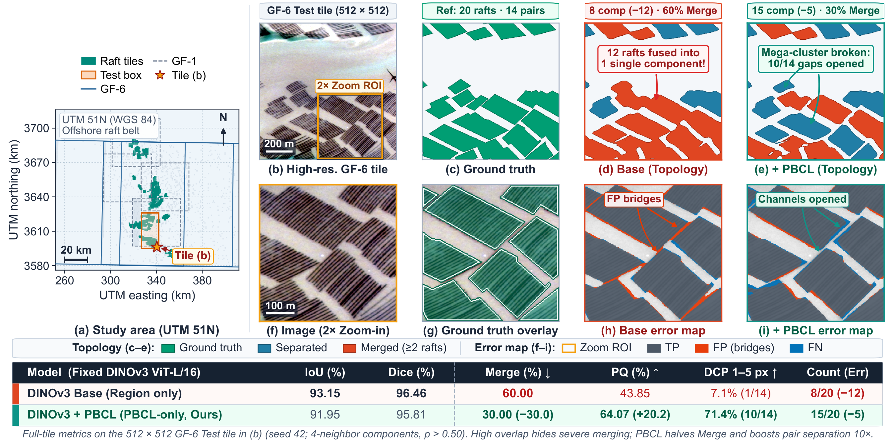
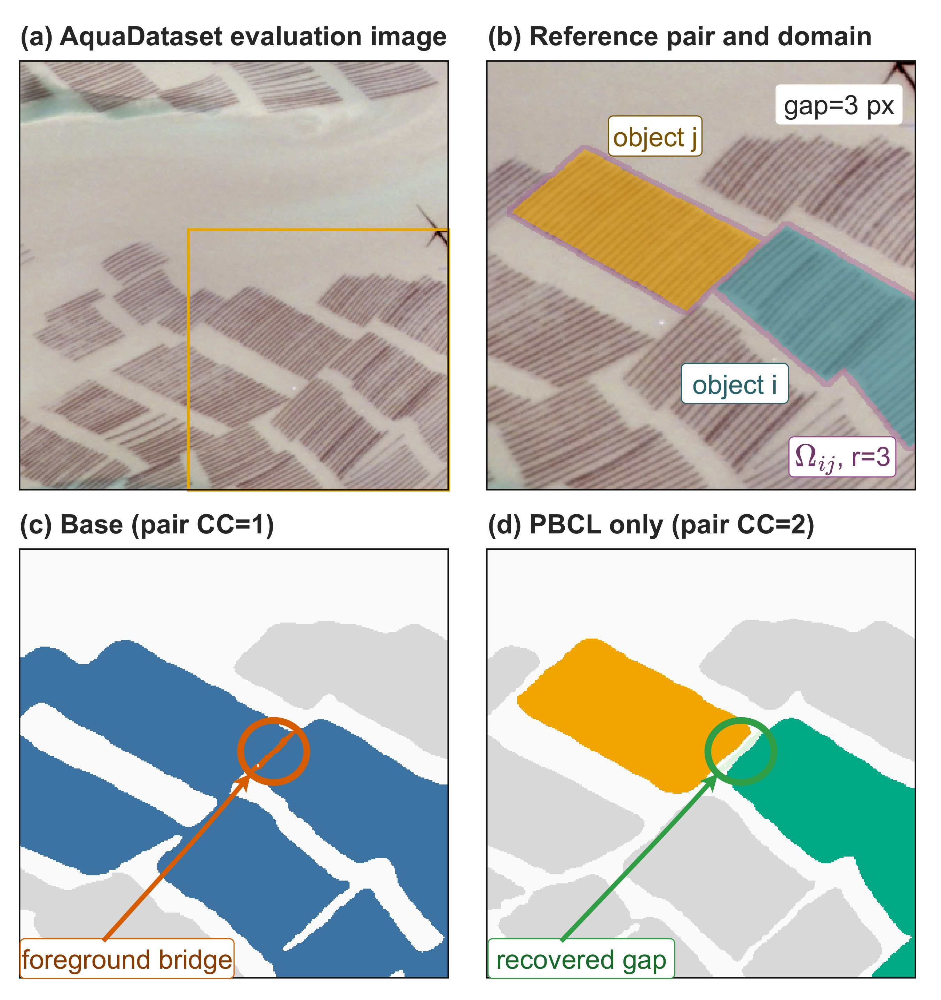
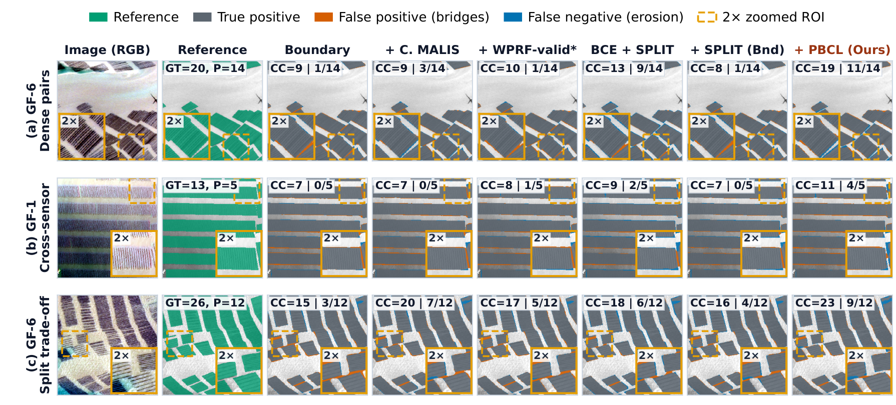
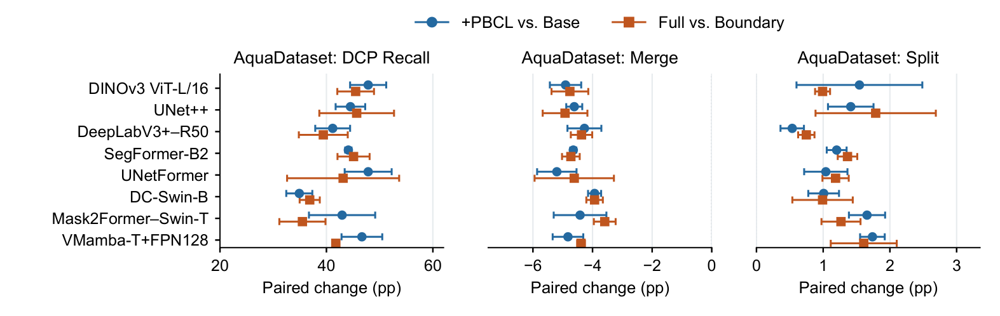
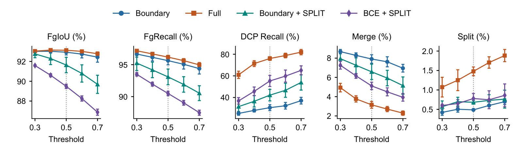

# PBCL：面向结构可分筏式养殖制图的成对瓶颈连通性损失

<p align="center">
  <a href="README.md">English</a> | <strong>简体中文</strong>
</p>

<p align="center">
  <a href="https://pytorch.org/"></a>
  <a href="LICENSE"></a>
  <a href="#复现实验指南"></a>
</p>

论文 **《Pairwise Bottleneck Connectivity Loss for Structurally Separable Raft-Aquaculture Mapping》** 官方代码与完整复现仓库：

> **Pairwise Bottleneck Connectivity Loss for Structurally Separable Raft-Aquaculture Mapping**  
> 臧翔腾、朱常胜、李豪杰、卢艳、崔宾阁  
> *山东科技大学*

---

## 核心动机与主要结论

密集筏式养殖区相邻浮筏之间通常仅有 1–5 像素的窄水道间隙。即使前景区域 IoU 超过 93%，微小的误连桥接也会导致大量相邻目标粘连合并，严重破坏个体可分性与计数精度。

**PBCL（成对瓶颈连通性损失）** 是一种**仅在训练阶段生效、即插即用**的结构损失函数：它直接作用于二值语义分割推理所用的前景概率图，**不增加任何可训练参数，推理阶段零额外开销**。

<p align="center">
  
</p>

1. **同载体多损失函数全面领先**：在主载体 **DINOv3 ViT-L/16** 与轻量级载体 **SegFormer-B2** 上，PBCL 在近邻对分离率（DCP Recall）、合并率（Merge）、全景质量（PQ）与计数误差（Count NMAE）上全面超越 **EW-BCE**、**soft-clDice**、**Constrained MALIS**、官方 2D 适配版 **WPRF-GT\*** / **WPRF-valid\*** 以及 **BCE + SPLIT** / **Boundary + SPLIT**。
2. **精准打开窄间隙 vs. 全局腐蚀边缘**：在固定阈值下 SPLIT 依靠全局收缩目标轮廓产生表面分离（Fg IoU 骤降至 88.13%–89.49%）；当在验证集上将前景召回率对齐至 Boundary@0.50 后，SPLIT 的分离优势彻底坍塌（DINOv3 上跌至 24.71% / 29.61%，低于 Boundary 的 30.59%），而 **PBCL 依然保持 +45.29 pp（DINOv3）与 +39.22 pp（SegFormer-B2）的 DCP Recall 净增益**。
3. **跨架构普适性（48/48 组配对种子全胜）**：在涵盖 CNN、Transformer、混合架构与 Mamba 四大家族的 **8 种二值分割架构**（DINOv3 ViT-L/16、UNet++、DeepLabV3+-R50、SegFormer-B2、UNetFormer、DC-Swin-B、Mask2Former-Swin-T、VMamba-T+FPN128）上，PBCL 在全部 **48/48** 组种子配对对比中均稳定提升 DCP Recall 并降低 Merge（架构级双侧精确符号/Wilcoxon 检验 $p = 0.0078$）。
4. **零重叠整景镶嵌与跨域验证**：在 4 个零重叠 GF-1/GF-6 整景测试走廊（单景约 286–297 $\text{km}^2$）上，PBCL 将宏平均 PQ 由 **78.31% 提升至 84.16%**，计数误差 Count NMAE 由 **13.52% 降至 4.04%**（64-px 内部碎斑过滤 Post）；在 **SpaceNet 2 Vegas** 密集建筑物（16,669 栋）跨域验证中，PBCL 在 8 种架构上同样实现 48/48 组配对全胜，SegFormer-B2 同载体 DCP Recall 达到 **63.54%**（Boundary 为 54.43%）。

---

## 方法原理与独立调用

PBCL 针对间距 $g_{ij} \le 5\text{ px}$ 的相邻实例对 $(G_i, G_j)$，在局部外扩交互带 $B_{ij}^{(r)}$（$r=3$）内对预测概率图 $P = \sigma(Z)$ 执行 $K=9$ 步可微四邻域 max–min 传播，计算两实例之间的有界瓶颈连通强度 $c_{ij}$，并对超过安全阈值 $\tau - m = 0.4$ 的误连路径施加平方铰链惩罚：

$$\mathcal{L}_{\mathrm{PBCL}} = \frac{1}{|\mathcal{P}|}\sum_{(i,j)\in\mathcal{P}} \max\bigl(0,\; c_{ij} - (\tau - m)\bigr)^2$$

<p align="center">
  
</p>

### 独立 PyTorch 模块（`pbcl`）

可直接将 PBCL 无缝接入任意二值语义分割模型，无需依赖 GeoSeg 训练框架：

```python
import torch
from pbcl import PairwiseBottleneckConnectivityLoss

criterion = PairwiseBottleneckConnectivityLoss(
    band_radius=3,   # 局部交互带半径 r
    iterations=9,    # 四邻域 max-min 传播步数 K
    threshold=0.5,   # 二值判定阈值 tau
    margin=0.1,      # 安全边界 m（对 > 0.4 的桥接施加惩罚）
)

# logits: (B, 1, H, W) 二值分割 logits
# instance_maps: (B, H, W) 整型实例编号图（0 为背景，1..N 为实例）
pbcl_loss, mean_bottleneck, num_pairs = criterion(
    logits, instance_maps, return_stats=True
)
total_loss = seg_loss + 0.1 * pbcl_loss
```

---

## 核心实验结果与多 Loss 对比

下方所有指标均为三随机种子（42、43、44）均值 ± 样本标准差，可通过仓库内置的汇总数据（[`results/`](results/)）一键复核：

```bash
python run.py verify-results
```

### 1. AquaDataset 同载体多损失函数对比（论文表 IV）

| 载体 / 训练目标 | Fg IoU ↑ | B-F1 ↑ | PQ ↑ | Merge ↓ | Split ↓ | DCP Recall ↑ | Count NMAE ↓ |
| --- | :---: | :---: | :---: | :---: | :---: | :---: | :---: |
| ***主载体：DINOv3 ViT-L/16*** | | | | | | | |
| Boundary | 92.94 ± 0.28 | 89.36 ± 0.82 | 80.42 ± 0.84 | 7.91 ± 0.44 | 0.49 ± 0.00 | 30.59 ± 2.70 | 12.59 ± 1.06 |
| Boundary + EW-BCE | 93.23 ± 0.01 | 90.16 ± 0.08 | 81.94 ± 0.52 | 6.56 ± 0.68 | 0.73 ± 0.21 | 39.41 ± 5.97 | 10.53 ± 0.62 |
| Boundary + soft-clDice | 93.02 ± 0.06 | 89.57 ± 0.14 | 80.21 ± 0.36 | 9.34 ± 0.07 | 0.50 ± 0.16 | 20.00 ± 0.59 | 12.31 ± 0.32 |
| Boundary + Constrained MALIS | 93.13 ± 0.02 | **90.23 ± 0.21** | 81.77 ± 0.08 | 6.22 ± 0.39 | 0.67 ± 0.03 | 42.75 ± 3.74 | 10.12 ± 0.44 |
| Boundary + WPRF-GT\* | 93.17 ± 0.09 | 89.93 ± 0.31 | 80.98 ± 0.36 | 7.78 ± 0.25 | **0.44 ± 0.08** | 30.59 ± 1.56 | 11.89 ± 0.67 |
| Boundary + WPRF-valid\* | **93.24 ± 0.12** | 90.17 ± 0.34 | 81.08 ± 0.54 | 7.34 ± 0.31 | 0.57 ± 0.16 | 33.14 ± 1.80 | 11.60 ± 0.59 |
| BCE + SPLIT (Eq. 15) | 89.49 ± 0.21 | 76.50 ± 1.09 | 75.42 ± 0.54 | 5.12 ± 0.38 | 0.78 ± 0.13 | 55.29 ± 5.09 | 10.06 ± 0.58 |
| Boundary + SPLIT | 91.64 ± 0.78 | 84.66 ± 2.72 | 78.75 ± 0.28 | 6.58 ± 0.80 | 0.68 ± 0.05 | 42.16 ± 5.34 | 10.64 ± 1.02 |
| **Boundary + PBCL（Full，本文）** | 93.14 ± 0.07 | 89.98 ± 0.34 | **83.36 ± 0.23** | **3.15 ± 0.35** | 1.48 ± 0.11 | **76.08 ± 1.70** | **8.19 ± 0.13** |
| ***轻量载体：SegFormer-B2*** | | | | | | | |
| Boundary | **92.91 ± 0.06** | **89.53 ± 0.12** | 78.97 ± 0.15 | 8.54 ± 0.10 | 0.89 ± 0.07 | 24.31 ± 0.90 | 14.68 ± 0.07 |
| Boundary + EW-BCE | 92.87 ± 0.13 | **89.53 ± 0.22** | 79.41 ± 0.30 | 7.78 ± 0.03 | 1.17 ± 0.15 | 29.61 ± 0.34 | 14.02 ± 0.25 |
| Boundary + soft-clDice | 92.23 ± 0.06 | 87.09 ± 0.36 | 78.25 ± 0.25 | 10.12 ± 0.20 | **0.37 ± 0.17** | 15.29 ± 1.02 | 12.80 ± 0.32 |
| Boundary + Constrained MALIS | 92.86 ± 0.08 | 89.23 ± 0.21 | 79.28 ± 0.15 | 7.60 ± 0.05 | 0.99 ± 0.10 | 31.96 ± 0.90 | 14.02 ± 0.37 |
| Boundary + WPRF-GT\* | 92.83 ± 0.08 | 89.24 ± 0.18 | 78.41 ± 0.39 | 8.87 ± 0.19 | 0.84 ± 0.12 | 20.98 ± 1.22 | 15.03 ± 0.54 |
| Boundary + WPRF-valid\* | 92.85 ± 0.09 | 89.31 ± 0.17 | 78.64 ± 0.19 | 8.76 ± 0.16 | 0.94 ± 0.15 | 21.37 ± 0.90 | 14.65 ± 0.45 |
| BCE + SPLIT (Eq. 15) | 88.13 ± 0.18 | 71.99 ± 0.66 | 72.02 ± 0.22 | 5.96 ± 0.03 | 1.06 ± 0.32 | 43.53 ± 0.00 | 13.06 ± 0.05 |
| Boundary + SPLIT | 90.79 ± 0.08 | 82.07 ± 0.28 | 76.29 ± 0.13 | 7.20 ± 0.03 | 1.12 ± 0.13 | 35.10 ± 0.90 | 12.87 ± 0.35 |
| **Boundary + PBCL（Full，本文）** | 92.82 ± 0.08 | 89.32 ± 0.13 | **80.71 ± 0.17** | **3.82 ± 0.20** | 2.26 ± 0.14 | **69.41 ± 2.12** | **11.81 ± 0.68** |
| *原生实例分割锚点：Mask2Former-Swin-T (Inst.)* | *93.01 ± 0.13* | *90.06 ± 0.13* | *84.72 ± 0.44* | *4.14 ± 0.42* | *3.87 ± 0.27* | *80.20 ± 2.96* | *7.24 ± 0.37* |

<p align="center">
  
</p>

### 2. 八种二值分割架构 2×2 监督因子消融（论文表 II）

<p align="center">
  
</p>

在全部 8 种架构（DINOv3 ViT-L/16、UNet++、DeepLabV3+-R50、SegFormer-B2、UNetFormer、DC-Swin-B、Mask2Former-Swin-T、VMamba-T+FPN128）上，PBCL-only 相对 Base 使 DCP Recall 提升 **+34.90 至 +47.84 pp**、Merge 降低 **3.93 至 5.20 pp**；Full 相对 Boundary 使 DCP Recall 提升 **+35.49 至 +45.69 pp**、Merge 降低 **3.59 至 4.92 pp**（48/48 组配对种子全部改善）。

### 3. 阈值鲁棒性与极低计算开销

<p align="center">
  
</p>

* 在 $\tau \in \{0.30, 0.40, 0.50, 0.60, 0.70\}$ 全部阈值下，PBCL 均稳定优于 Boundary，且不存在 SPLIT 随阈值升高出现的前景召回率坍塌。
* 在 RTX 5090 D v2（batch 12, bfloat16）上，DINOv3 ViT-L/16 单步训练开销在中位对密度（2 对/batch）下仅增加 **+1.45%**，在 90 分位密度（6 对/batch）下仅增加 **+4.41%**，峰值显存保持 **9.50 GiB** 不变，**部署推理开销为 0%**。

---

## 数据集获取与环境配置

* **AquaDataset**（GF-1 / GF-6 四波段 B/G/R/NIR 遥感影像与实例标注）：
  * [Google Drive](https://drive.google.com/drive/folders/1PL_MIxu_Jt69cbeqNZcCL4exIHHCPSZa?usp=sharing)
  * [百度网盘](https://pan.baidu.com/s/1otIZdScCu37XIebyO-4FjA?pwd=98v9)（提取码：`98v9`）
  * 论文冻结的地理留出划分清单已内置于 [`splits/aquadataset_geographic_holdout_v1/`](splits/aquadataset_geographic_holdout_v1/)。
* **SpaceNet 2 Vegas**（WorldView-3 密集建筑物）：
  * [SpaceNet Buildings Dataset v2](https://spacenet.ai/spacenet-buildings-dataset-v2/)
  * 划分协议元数据见 [`splits/spacenet2_vegas_dense_close_v1/`](splits/spacenet2_vegas_dense_close_v1/)。

```bash
export AQUADATASET_ROOT=/path/to/aquav3-geographic-holdout-v1
export VEGAS_ROOT=/path/to/SpaceNet2/VegasDenseClosePBCL_v1
export PBCL_PRETRAINED_ROOT=/path/to/pretrained_cache
export PBCL_OUTPUT_ROOT=./outputs
```

---

## 复现实验指南

```bash
# 安装依赖（请先按 CUDA 环境安装 PyTorch 2.x）
python -m pip install -r requirements.txt

# 1. 运行单元测试 & 一键核验论文全部表 II–VI 结果（仅需 CPU，无需下载影像）
pytest -v
python run.py verify-results

# 2. 查看全部 111 个实验配置（覆盖 AquaDataset 与 SpaceNet 2 Vegas）
python run.py list
python run.py list --dataset aquadataset --query segformer
python run.py inspect aquadataset/full --seed 42
python run.py inspect aquadataset/cmalis --seed 42
python run.py inspect vegas/segformer_b2__full --seed 42

# 3. 启动训练（支持 --seed 42 / 43 / 44）
python run.py preflight aquadataset/full --seed 42
python run.py train     aquadataset/full --seed 42
python run.py train     aquadataset/segformer_b2_full --seed 42
python run.py train     aquadataset/segformer_b2_cmalis --seed 42
python run.py train     vegas/segformer_b2__full --seed 42

# 4. 评估测试集权重
python run.py eval aquadataset/full --checkpoint /path/to/best_overall.ckpt --split test

# 5. 零重叠整景滑窗镶嵌评估（论文表 V）
python scripts/evaluate_full_scene_corridor.py \
  --config configs/aquadataset/full.py \
  --checkpoint /path/to/best_overall.ckpt \
  --image-tif /path/to/corridor_S2.tif \
  --gt-instance-npz /path/to/corridor_S2_gt.npz \
  --output-json outputs/corridor_S2_full.json
```

---

## 许可证与引用

本项目代码（第三方模块除外）遵循 [GNU GPL v3.0](LICENSE) 开源协议；DINOv3、Constrained MALIS、WPRF 等第三方组件遵循各自目录下 `LICENSE` / `SOURCE.md` 声明。

```bibtex
@article{zang2026pbcl,
  title={Pairwise Bottleneck Connectivity Loss for Structurally Separable Raft-Aquaculture Mapping},
  author={Zang, Xiangteng and Zhu, Changsheng and Li, Haojie and Lu, Yan and Cui, Binge},
  journal={IEEE Journal of Selected Topics in Applied Earth Observations and Remote Sensing (J-STARS)},
  year={2026},
  note={Under review}
}
```
